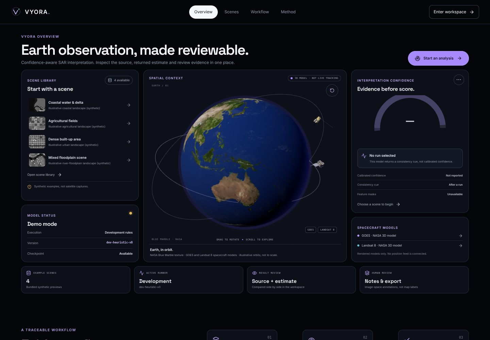
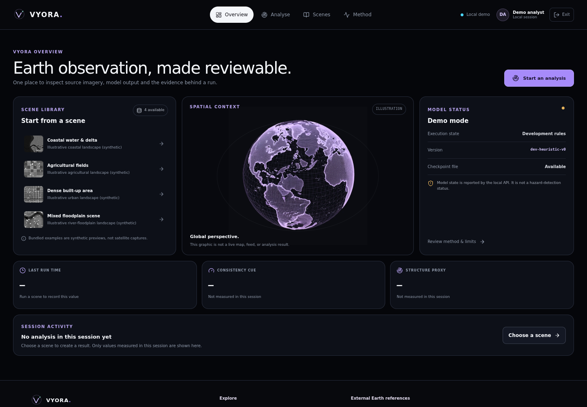
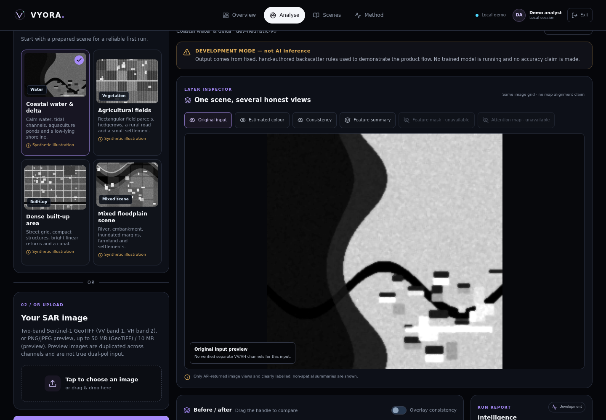
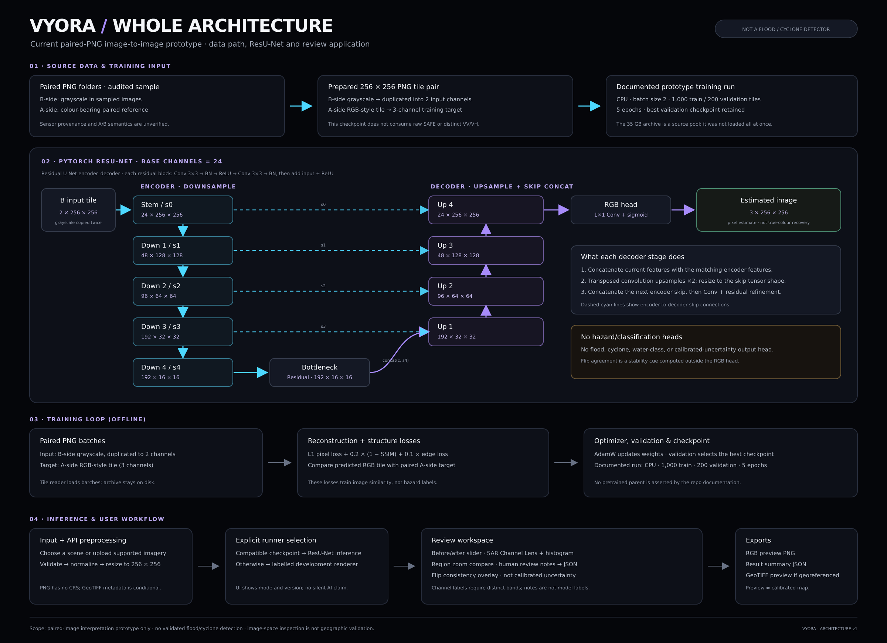

<p align="center">
  
</p>

<h1 align="center">VYORA</h1>

<p align="center"><strong>Read the signal. Keep the evidence.</strong></p>
<p align="center">A local-first workspace for inspecting paired-image estimates without hiding the source or overstating what the model knows.</p>
<p align="center"><sub>RESEARCH PROTOTYPE · REACT + FASTAPI · IMAGE-TO-IMAGE</sub></p>

<p align="center">
  <a href="#quick-start">Quick start</a> ·
  <a href="#screenshots">Screenshots</a> ·
  <a href="#architecture">Architecture</a> ·
  <a href="#model-and-data-status">Model & data status</a> ·
  <a href="#documentation">Documentation</a>
</p>

---

## What Vyora is

Vyora is an experimental image-to-image application for comparing an input image with an estimated visual output. The React/Vite interface talks to a local FastAPI service and keeps source imagery, run details, derived views and human review tools together.

**It is not a flood detector, cyclone forecast, land-cover classifier, official map or warning system.** The source archive's sensor semantics and licence have not been independently verified, and the current PNG model does not consume georeferenced SAR measurements.

## Screenshots

These are screenshots of the running local web app. The bundled scene thumbnails are **synthetic illustrations**, not satellite captures; output shown in the result view is from the development runner and is not a real-world interpretation.

<p align="center">
  
</p>

<table>
  <tr>
    <td width="50%" valign="top">
      
      <p align="center"><sub>Local workspace · synthetic demo scenes · live API status</sub></p>
    </td>
    <td width="50%" valign="top">
      
      <p align="center"><sub>Result review · source remains visible · unavailable layers are labelled</sub></p>
    </td>
  </tr>
</table>

## What the app can do

- Explore an interactive, NASA-textured 3D Earth; drag to rotate, use arrow keys, or scroll the landing dashboard to move the camera. A NASA GOES and a Landsat 8 3D spacecraft model orbit on illustrative, not-to-scale paths.
- Open NASA Eyes for an external view of real Earth-observing satellite positions, or the NOAA GOES animation reference. Neither is connected to Vyora's local model runs.
- Browse four bundled synthetic scenes or provide a supported local image.
- Compare the original input, estimated colour output and runner-specific consistency view.
- Review source dimensions, observed API runtime, CRS when present, and API-returned palette/rule-derived shares when present.
- Inspect input channels and add human-authored image-space notes.
- Export the output PNG and machine-readable JSON result; a georeferenced preview is available only for compatible GeoTIFF inputs.

The layer controls do **not** fabricate learned segmentation masks or attention maps. Class shares, if returned by a runner, are explanatory palette/rule estimates—not validated geographic detections.

## Quick start

### 1. Install backend dependencies

Use Python 3.11 or a compatible Python environment. PyTorch is installed separately from the API requirements:

```bash
python -m pip install -r backend/requirements.txt
python -m pip install torch --index-url https://download.pytorch.org/whl/cpu
```

Skip the PyTorch install if the active environment already has a compatible version. For CUDA, choose the matching command from the official [PyTorch install selector](https://pytorch.org/get-started/locally/).

### 2. Start the local API

From the repository root, explicitly select the corrected B→A checkpoint rather than the legacy A→B checkpoint:

```bash
export VYORA_CHECKPOINT="$PWD/backend/checkpoints/vyora_resunet_b_to_a.pt"
python -m uvicorn app.main:app --app-dir backend --host 0.0.0.0 --port 8000
```

PowerShell equivalent:

```powershell
$env:VYORA_CHECKPOINT = "$PWD\backend\checkpoints\vyora_resunet_b_to_a.pt"
python -m uvicorn app.main:app --app-dir backend --host 0.0.0.0 --port 8000
```

### 3. Start the web app

In a second terminal:

```bash
cd frontend
npm ci
npm run dev
```

Open the URL printed by Vite (normally <http://localhost:5173>). The API documentation is at <http://localhost:8000/docs>. Keep both processes running. The Vite development server proxies `/api` requests to the local FastAPI service.

The app reports its active mode and model version from the API. If PyTorch or the selected checkpoint cannot be loaded, the service may use a clearly labelled development fallback; check the workspace status before interpreting an output.

## Architecture

The diagram separates the current paired-PNG experiment from the application flow. It describes the audited image characteristics without claiming that the source folders are verified Sentinel-1/Sentinel-2 products.

<p align="center">
  
</p>

- [Open the architecture diagram as SVG](docs/diagrams/vyora_whole_architecture.svg)
- [Read the written architecture notes](docs/ARCHITECTURE.md)

### Current image-to-image contract

```text
B-side grayscale PNG  → duplicate into 2 channels → compact ResU-Net (2 → 3) → A-side RGB-style estimate
       no CRS                 no separate VV/VH                               image estimate, not truth
```

The compact PyTorch ResU-Net uses residual blocks and U-Net skip connections. The corrected checkpoint was trained on prepared 256 × 256 PNG pairs; its input direction is based on sampled channel statistics, not verified sensor metadata. See [ML status](docs/ML_STATUS.md) and [model card](docs/MODEL_CARD.md) for the exact scope and known limitations.

## Model and data status

The repository tracks two checkpoints: an earlier **legacy A→B** experiment and a corrected **B→A paired-PNG prototype** at `backend/checkpoints/vyora_resunet_b_to_a.pt`. Do not use the legacy checkpoint as evidence of colourization. The corrected experiment maps a grayscale B-side image—duplicated into two model channels—to an A-side RGB-style target.

A limited folder audit found B-side images were grayscale and A-side images were often colour-bearing. That is not proof of sensor identity, acquisition conditions, or semantic pairing. The original large image archive and local manifest are not included in this repository.

### Reported subset evaluation

The evaluation report compares the corrected checkpoint with a simple palette baseline on a 200-tile subset. It found better paired-pixel similarity for the model on that subset, but the output remains noticeably muted and geographic independence was not independently verified.

| Method | MAE ↓ | PSNR ↑ | SSIM ↑ | Mean RGB spread |
|---|---:|---:|---:|---:|
| Palette baseline | 0.35373 | 8.14 dB | 0.24769 | 0.39119 |
| B→A ResU-Net | 0.09632 | 20.99 dB | 0.67069 | 0.03778 |
| Paired target | — | — | — | 0.13053 |

These are image-similarity measurements against the selected paired PNG subset, **not** geographic accuracy, hazard-detection performance or proof of true-colour recovery. The prediction's mean RGB spread is much lower than the target's; this colour-collapse failure mode matters. Full context and caveats are in [Evaluation](docs/EVALUATION.md).

### Input and output limits

- **PNG/JPEG previews** are converted to grayscale and duplicated into two channels for the interface workflow. They carry no CRS or affine transform.
- **Two-band GeoTIFF support** exists in the API, but it is not compatible with the current PNG-trained checkpoint. Inputs must already be calibrated and co-registered for any scientifically meaningful SAR use; the service does not perform those corrections.
- The consistency view is a method-stability cue, not calibrated uncertainty.
- No learned water, vegetation, building, land-cover, flood or cyclone classifier is included.
- A CRS/extent-preserving GeoTIFF export, when available, is a model-size preview—not a full-resolution analytical product.

## Data provenance and future GeoTIFF experiments

For a separate, compatible GeoTIFF experiment, consult the [official SEN12MS dataset page](https://mediatum.ub.tum.de/1474000) and keep the Toolbox clone's split lists available. **Do not assume** band indexes, reflectance scale, labels or licence; inspect the files and source terms first.

Inspect a matched pair before preparing a manifest:

```bash
python scripts/inspect_sen12ms_pair.py \
  --s1 /path/to/tile_s1.tif \
  --s2 /path/to/tile_s2.tif
```

Only after verifying metadata, choose the band indexes and scale explicitly:

```bash
python scripts/prepare_sen12ms_manifest.py \
  --data-root /path/to/extracted/SEN12MS \
  --train-list /path/to/SEN12MS/splits/train_list.txt \
  --test-list /path/to/SEN12MS/splits/test_list.txt \
  --vv-band 1 --vh-band 2 \
  --rgb-bands 4 3 2 --optical-scale 10000 \
  --licence-note "Record the actual dataset terms and attribution"
```

The band indexes and scale above are examples and require verification against the actual data. See [data card](docs/DATA_CARD.md), [licences and attribution](docs/LICENSES_AND_ATTRIBUTION.md) and [final training runbook](docs/FINAL_TRAINING_RUNBOOK.md) before starting a separate experiment.

## Documentation

| Topic | Guide |
|---|---|
| System design | [Architecture](docs/ARCHITECTURE.md) · [Technical stack](docs/TECH_STACK.md) |
| Usage | [API](docs/API.md) · [Install and troubleshooting](docs/INSTALL.md) · [Demo script](docs/DEMO_SCRIPT.md) |
| Scientific scope | [ML status](docs/ML_STATUS.md) · [Model card](docs/MODEL_CARD.md) · [Data card](docs/DATA_CARD.md) · [Evaluation](docs/EVALUATION.md) |
| Development | [Test checklist](docs/TEST_CHECKLIST.md) · [Project details](docs/PROJECT_DETAILS.md) · [Implementation decisions](docs/IMPLEMENTATION_DECISIONS.md) |
| Presentation | [PPT alignment and selection guide](docs/PPT_ALIGNMENT_AND_SELECTION_GUIDE.md) |
| Visual assets | [3D globe textures, spacecraft model attribution and external references](docs/ASSETS.md) |

## Development checks

```bash
cd frontend && npm run build
cd .. && .venv/bin/python -m pytest -q
```

The tests cover input contracts, API behaviour, geospatial handling and ML data utilities. They do not validate model accuracy or geographic generalization.

---

<p align="center"><sub>Vyora is an experimental research demonstrator. Verify outputs with authoritative data and qualified review before any real-world use.</sub></p>
